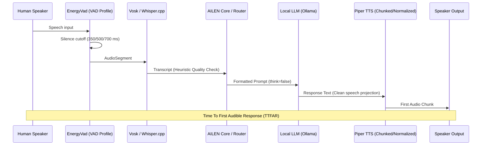

# Adaptive Inference & Memory Residency Architecture (2026)

> **Estado:** investigación histórica. La política canónica vigente está en
> ADR-010 y `docs/hardware/LOCAL_MODEL_QUALIFICATION.md`: 4/8 GB conservan
> reservas estrictas; 16/32/64+ GB y GPU dedicada usan envelope dinámico y sólo
> artefactos calificados por hardware/modelo/runtime. Las cifras fijas de las
> tablas siguientes no son soporte ni límites actuales.

## 1. Context & Core Principles

AILEN (*Asistente Inteligente Local, Evolutivo y Natural*) operates on heterogeneous hardware topologies:
- High-end workstations with dedicated GPUs (e.g. Ryzen 5 5500 + RTX 3060 12 GB in development lab).
- Low-power mini-PCs and notebooks with integrated graphics (e.g. Banghó Zero G05, 8 GB RAM).
- Legacy hardware and netbooks (e.g. SF20BA, 4 GB RAM).
- Ultra-low memory devices and IoT nodes (~2 GB RAM).
- Decoupled LAN Brains and optional remote cloud backends.

### Fundamental Rules

1. **The Assistant is NOT the LLM:**
   Identity, personality, long-term memory, permissions, tool policies, outbound privacy, and conversation state machine belong to AILEN Core. The LLM is an interchangeable and replaceable cognitive engine.

2. **No Model Hopping Mid-Session:**
   Dynamic switching between model architectures or sizes on a per-query basis is strictly prohibited. Changing models mid-session induces:
   - Severe cold-start latencies.
   - VRAM / RAM thrashing and cache evictions.
   - Unpredictable latency spikes and energy waste.
   Model changes are restricted to startup, explicit profile reconfiguration, backend failovers, administrative overrides, or new session launches.

3. **Deterministic Fast-Path Prepared for R3C:**
   `classify_fast_path_intent()` recognizes only conservative, unequivocal command forms. R3B.4 prepares classification/routing boundaries; real music/timer/note/web tool execution is intentionally deferred to R3C. Ambiguous phrases remain chat rather than risking a wrong action.

---

## 2. Inference Profiles (`InferenceProfile`)

Unlike `DeviceProfile` (which classifies node topology: `SATELLITE`, `CLOUD`, `HYBRID`, `LOCAL`, `LAN_BRAIN`), `InferenceProfile` classifies local cognitive capacity:

| Profile | Target Hardware Profile | Recommended Runtime | Model Size Class | Working RAM/VRAM Budget | Default `keep_alive` |
| :--- | :--- | :--- | :--- | :--- | :--- |
| **`RULE_ONLY`** | ~2 GB thin clients, 4 GB default netbooks, Satellite nodes | None | 0 (No local LLM) | 0 MB | `0` |
| **`FAST`** | 8 GB CPU-only or modest discrete GPU (2–6 GB VRAM) | `llama.cpp` (CPU) / `ollama` (GPU) | Small (0.5B – 4B) | ~1.2 GB – 3.5 GB RAM / ~2–4 GB VRAM | `5m` |
| **`BALANCED`** | 16+ GB CPU workstation or 6–10 GB VRAM GPU | `llama.cpp` (CPU) / `ollama` (GPU) | Small – Medium (3B – 7B) | ~5 GB – 7 GB RAM / ~6–8 GB VRAM | `15m` |
| **`QUALITY`** | 10+ GB VRAM GPU + 16+ GB RAM (Lab workstation) | `ollama` / `llama.cpp` (CUDA) | Medium (7B – 14B) | Dedicated VRAM offload (up to 10+ GB) | `30m` |

---

## 3. Hardware Recommendation Decision Matrix

The deterministic selector `recommend_inference_profile()` computes the target tier based on measured hardware probes:

1. **Unknown / Missing RAM Probe:** Fail-closed to `RULE_ONLY` (`HARDWARE_RAM_UNKNOWN`).
2. **Dedicated GPU Check (VRAM $\ge$ 2048 MB):**
   - VRAM $\ge$ 10,000 MB and RAM $\ge$ 14,000 MB $\to$ **`QUALITY`** (`INFERENCE_PROFILE_QUALITY_GPU_HIGH_VRAM`).
   - VRAM $\ge$ 5,500 MB $\to$ **`BALANCED`** (`INFERENCE_PROFILE_BALANCED_GPU`).
   - VRAM 2,048 – 5,500 MB $\to$ **`FAST`** (`INFERENCE_PROFILE_FAST_GPU`).
3. **CPU-Only / Shared Graphics Tiers:**
   - RAM $<$ 3,500 MB (~2 GB) $\to$ **`RULE_ONLY`** (`INFERENCE_PROFILE_RULE_ONLY_LOW_RAM`).
   - RAM 3,500 – 6,500 MB (~4 GB) $\to$ **`RULE_ONLY`** (Conservative default; experimental **`FAST`** only if explicitly opted in).
   - RAM 6,500 – 12,500 MB (~8 GB) $\to$ **`FAST`** (`INFERENCE_PROFILE_FAST_CPU_8GB`).
   - RAM $\ge$ 12,500 MB (16+ GB) $\to$ **`BALANCED`** (`INFERENCE_PROFILE_BALANCED_CPU_16GB`).

---

## 4. Local Candidate Models & Lab Verification (2026)

| Candidate Model | Target Profile | Native Reasoning / Thinking | Verified for Download | Notes |
| :--- | :--- | :--- | :--- | :--- |
| **`qwen3.5:9b`** | `QUALITY` | Yes (`think=false` supported) | Laboratory Reference | Verified physically in Asrock lab on RTX 3060. |
| **`qwen2.5-coder:3b`** | `FAST` | No | Installed in Lab | Fast conversational and coding candidate (89 tok/s). |
| **`llama-3.2-3b-instruct`** | `FAST` | No | Candidate (`downloadable=false`) | Multilingual dialogue candidate; requires physical benchmark. |
| **`qwen3.5-4b-instruct`** | `FAST` / `BALANCED` | Yes (`think=false` required) | Candidate (`downloadable=false`) | Efficient dialogue candidate; requires physical benchmark. |
| **`gemma-3-4b-instruct`** | `BALANCED` | No | Candidate (`downloadable=false`) | High-quality compact candidate; requires physical benchmark. |

---

## 5. Time To First Audible Response (TTFAR) Pipeline

The live Lab now wires TTFAR from `VOICE_ENDED` to `SPEECH_STARTED`. `SPEECH_STARTED` is emitted only when the first playable PCM buffer is about to be submitted to the output backend. This is an operational proxy for first audible response; it does not pretend to measure physical DAC/headphone propagation latency.

## 6. Piper chunked synthesis and prewarm

The installed `piper-tts` Python API exposes `PiperVoice.synthesize() -> Iterable[AudioChunk]` (one chunk per sentence). AILEN therefore uses a cached Python voice for incremental sentence playback as its sole canonical synthesis route. Lab prewarms the voice before opening microphone capture so the first user turn does not normally pay the ~2 s model-load cost observed on Asrock. After caching, the first chunk of a short sample was observed at ~65 ms.

## 7. Safety/truthfulness constraints

- A user preference can downshift an inference tier but cannot force a tier above measured hardware capability.
- Candidate runtime aliases must identify the same concrete model; `qwen3.5:4b` does not alias generic `qwen3.5`, and Qwen 2.5 Instruct does not alias Qwen 2.5 Coder.
- `RecommendedDeployment.local_model` remains unset until ModelPlanner/runtime inventory resolves a concrete model.
- External provider cost is `UNKNOWN` until an actual provider/pricing configuration exists.
- Generic OpenAI-compatible backends do not receive Ollama-specific `keep_alive` or thinking fields; those controls live in the native Ollama backend.
